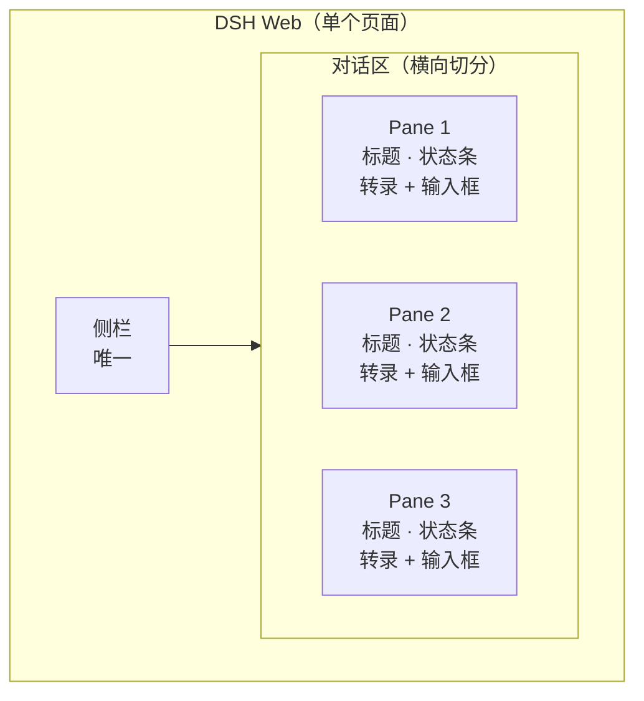
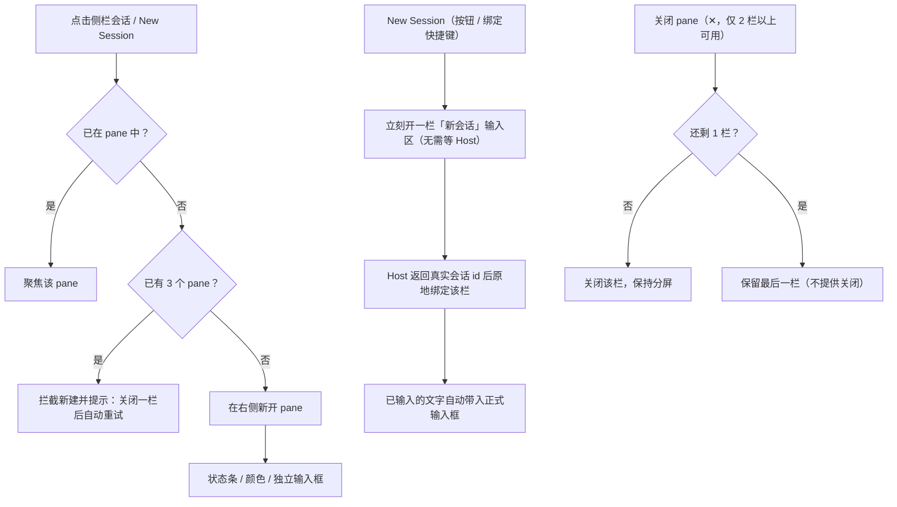
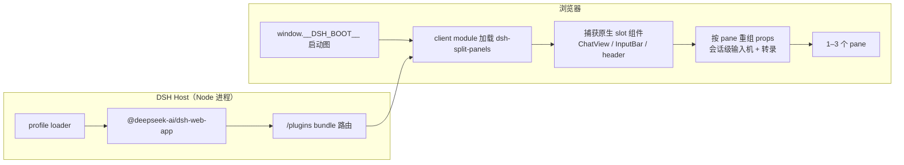
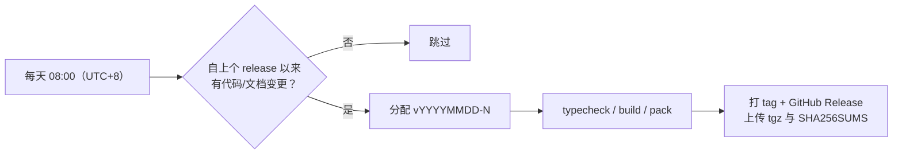

# dsh-split-panels

[](https://github.com/HZWzzl/dsh-split-panels/actions/workflows/release.yml)
[](https://github.com/HZWzzl/dsh-split-panels/actions/workflows/ci.yml)
[](LICENSE)

**把 DeepSeek Harness 的对话区横向切成 1–3 栏，侧栏和顶栏始终只有一份。**

同时盯着几个会话时，不再来回切换：每个 pane 都有独立的转录、输入框、状态条和颜色标记；点击侧栏会话即可新开一栏，最多三栏。



> 三个 pane 是同一页面里的三块对话区，不是三个浏览器标签页；顶栏、侧栏、主题、语言都只有一份。

## 为什么用它

| 场景 | 原生界面 | 使用本插件 |
| --- | --- | --- |
| 对照两个会话的结论 | 反复点侧栏切换 | 并排常驻，互不打扰 |
| 一边跑长任务，一边问新问题 | 切走就看不到进度 | 各栏独立流式渲染 |
| 找「刚才那个会话」 | 靠标题猜 | 颜色 + 常驻栏位 |
| 看会话最新状态 | 进入会话才知道 | 每栏顶部状态条常显 |

## 行为



- **启动即分屏**：打开页面时，当前有历史的会话直接作为 1 个 pane 出现；不再有「原生单会话 ↔ 分屏」两套界面。
- **新建会话秒开**：点 New Session（stock 为会话新建绑定了 Mod+N 时快捷键同样生效）立刻在右侧出现一栏「新会话」，输入框马上可以打字，不再阻塞等 Host 建好会话；Host 返回真实会话后该栏原地切换成正式会话，未发送的文字自动带入（回车则作为首条消息排队发送）。Host 创建失败/超时会显示重试与关闭。诊断见 `health().pendingNewSessions` / `health().lastNewSessionResolve`。
- **1–3 栏**：单栏占满正文宽度；第 4 栏会被拒绝。拆分布局记忆在 `localStorage`，刷新后恢复。
- **最后一栏不可关闭**：✕ 只在两栏及以上出现；关闭最后一栏会退回原生单会话视图，与“正文区始终是 1–3 个 pane”的模型冲突，因此不提供。退出分屏用 `window.__dshSplitPanels.setEnabled(false)`（或 `dsh-session-hotkeys` 的 Alt+W）。
- **状态条保留**：每栏顶部渲染原生 session header 的状态入口（Agent Team、Standard mode、子代理、后台任务、定时任务、⋯ 更多操作），与原生页同一套组件、同一套交互。
- **颜色区分**：每栏有颜色（顶部色条 + 淡色背景 + 色点），侧栏对应会话卡片同步同色；点色点可选七种彩虹预设色，或用最后一格从调色板自定义任意颜色。
- **流停滞自愈**：某栏的 turn 还在运行、正文却长时间不再更新（上游会话流偶发停滞）时，插件会自动在该栏重拉一次会话窗口，不用刷新整页、其它栏不受影响；每轮最多 2 次。诊断见 `health().lastStreamRecovery`。
- **桌面限定**：手机 / 窄触屏视口自动停用，保持原生界面；窗口变宽后自动恢复。
- **不替换已有栏**：已打开的会话只聚焦，不重复开栏，也不会顶掉其他 pane。
- **行内操作不误开栏**：侧栏会话卡片上的 ⋯（会话操作）、归档、置顶等按钮只执行原生动作，不会在正文区开 pane；点标题/卡片主体才会打开或聚焦 pane。

## 架构



- Host 半侧是空插件，只为让 loader/Profile 能解析并挂载这个包。
- 浏览器半侧通过公开的 slot 表捕获原生组件，按会话重组，不复制 DSH 源码。
- `lib/` 为构建产物并随仓库提交，安装后无需再构建。

## 安装

### 从 Release 安装（推荐）

1. 到 [Releases](https://github.com/HZWzzl/dsh-split-panels/releases/latest) 下载 `dsh-split-panels-<YYYY.MM.DD-N>.tgz` 与 `SHA256SUMS`（tag 为 `v<YYYYMMDD-N>`，例如 `v20261022-1` ↔ `2026.10.22-1`）。
2. 校验并安装：

```sh
sha256sum -c SHA256SUMS --ignore-missing
dsh plugin --profile web add ./dsh-split-panels-<YYYY.MM.DD-N>.tgz
```

3. 重启 `dsh web`，刷新页面。插件会自动加入 profile 的 `dsh.profile.bundles`。

### 从 GitHub 源码安装

```sh
dsh plugin --profile web add github:HZWzzl/dsh-split-panels
```

固定版本：`github:HZWzzl/dsh-split-panels#v20261022-1`。

### 本地开发

```sh
git clone https://github.com/HZWzzl/dsh-split-panels.git
cd dsh-split-panels && pnpm install && pnpm build
dsh plugin --profile web add link:$PWD
```

建议在独立 profile 里试插件：`dsh --profile dev --from-default-profile web`，避免污染日常 `web` profile。

## 兼容性

| 项目 | 要求 |
| --- | --- |
| DeepSeek Harness | `>=0.2.0-rc.2 <0.3.0`（`engines.dsh`，已在 0.2.1-rc.2 验证） |
| Node.js | `>=22.19` |
| 平台 | DSH Web；桌面视口（窄屏/触屏自动停用） |
| 浏览器 | 支持 `window.__ModuleLoader__` 的 DSH Web 客户端（Chromium / Firefox / Safari 现代版本） |

DSH 处于开发者预览期，客户端 slot / 平台模块表可能变化；遇到不兼容请开 issue 并附 `window.__dshSplitPanels.health()` 输出。

## 数据与诊断

| `localStorage` key | 内容 |
| --- | --- |
| `dsh.split-panels.tree.v1` | 分栏布局（1–3 个 pane） |
| `dsh.split-panels.colors.v1` | 每个 pane 的颜色 |
| `dsh.split-panels.enabled.v1` | 总开关 |
| `dsh.split-panels.health.v1` | 崩溃保护记录 |

```js
window.__dshSplitPanels.health()            // 版本 / panes / 几何 / 新建会话诊断 / lastError
window.__dshSplitPanels.setEnabled(false)   // 关闭分屏
window.__dshSplitPanels.reset()             // 清除持久化布局
```

排障：看不到分屏时先看 `health()` 的 `enabled / safeMode / panes / geometry`；`retry()` 可重新激活。连续崩溃才会进入安全模式，原生界面始终可用。新建会话慢/卡住时看 `health().pendingNewSessions`（仍在等 Host 返回会话 id 的临时栏数，0 表示没有在等）与 `health().lastNewSessionResolve`（最近一次解析记录：`{sessionId, pendingId, ms, swapped, handedOff, at}`，`ms` 是「点击 → Host 会话就绪」的毫秒数）。

## 开发

```sh
pnpm install
pnpm typecheck        # tsc --noEmit
pnpm build            # src/*.ts → lib/*.js（产物提交进仓库）
pnpm check            # typecheck + build + 校验 lib 与源码一致
pnpm version:check    # 校验 package.json 版本格式
pnpm pack --pack-destination release   # 生成安装 tgz
```

### 自动发版



- 定时任务：`.github/workflows/release.yml`，每天 `08:00`（Asia/Shanghai，即 `00:00 UTC`）。
- 版本号：tag 为 `vYYYYMMDD-N`（当天第 N 次，如 `v20261022-1`）；`package.json` 使用等价的严格 SemVer `YYYY.MM.DD-N`，保证 pnpm 可安装。
- 无更新自动跳过；也可在 Actions 页手动 `Release → Run workflow`，勾选 `dry_run` 只验证不发版。
- CI（`.github/workflows/ci.yml`）在 push / PR 上跑 typecheck + build + 产物一致性检查。

## 许可与致谢

本项目以 [GPL-3.0-only](LICENSE) 发布。

插件概念与早期界面 fork 自 [YEYEYEYESHIFU/dsh-split-screen](https://github.com/YEYEYEYESHIFU/dsh-split-screen) v1.7.0（MIT），当前实现已按本仓库行为重写；DeepSeek Harness 本体为 MIT。相关版权与许可全文见 [THIRD_PARTY_NOTICES.md](THIRD_PARTY_NOTICES.md)。
