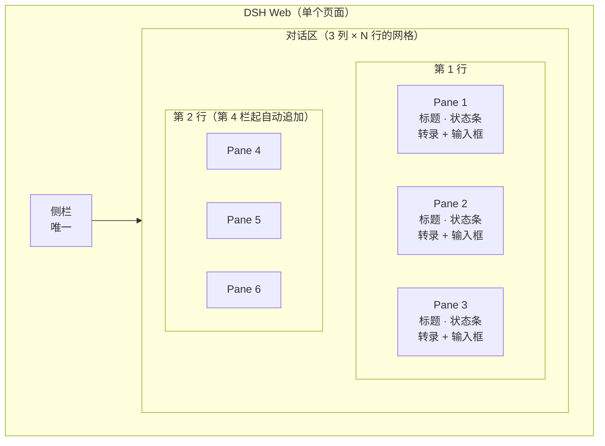
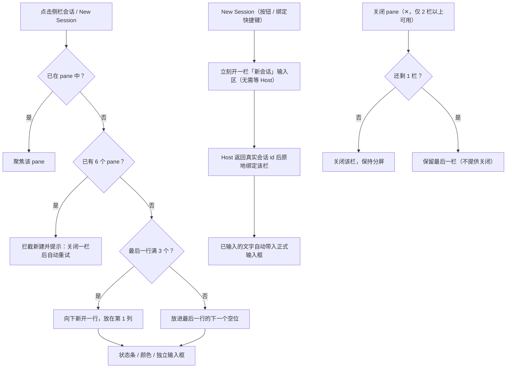
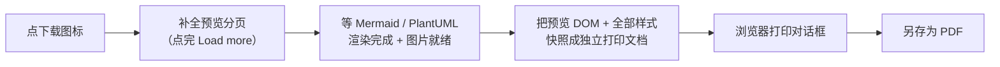
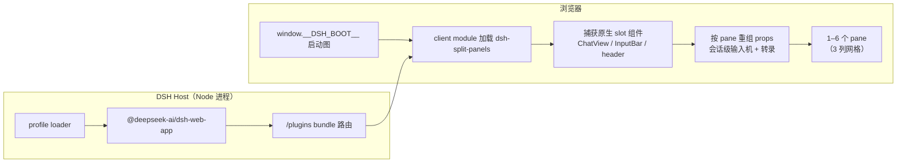
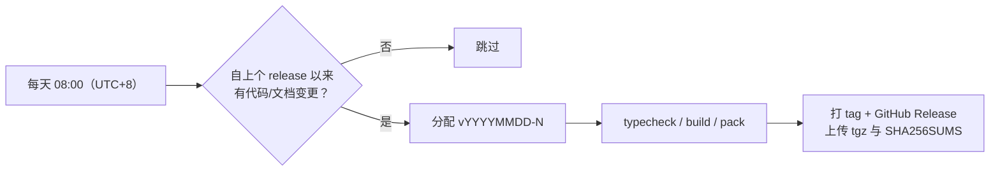

# dsh-split-panels

[](https://github.com/HZWzzl/dsh-split-panels/actions/workflows/release.yml)
[](https://github.com/HZWzzl/dsh-split-panels/actions/workflows/ci.yml)
[](LICENSE)

**把 DeepSeek Harness 的对话区切成最多 6 栏的网格：固定 3 列，满了向下追加一行。侧栏和顶栏始终只有一份。**

同时盯着几个会话时，不再来回切换：每个 pane 都有独立的转录、输入框、状态条和颜色标记；点击侧栏会话即可新开一栏，第 4 栏开始向下换行，最多 2 行 × 3 列。

同一份 bundle 还提供**右侧文档预览的「导出 PDF」**：预览 Markdown 时点一下，打印对话框里选「另存为 PDF」，得到的 PDF 与右侧栏所见一致——Mermaid / PlantUML 图仍是矢量图，表格、代码、图片、主题配色都不缺。



> 网格里的每个 pane 都是同一页面里的一块对话区，不是多个浏览器标签页；顶栏、侧栏、主题、语言都只有一份。列数固定 3，行数按需增加（最多 2 行，共 6 栏）。

## 为什么用它

| 场景 | 原生界面 | 使用本插件 |
| --- | --- | --- |
| 对照两个会话的结论 | 反复点侧栏切换 | 并排常驻，互不打扰 |
| 一边跑长任务，一边问新问题 | 切走就看不到进度 | 各栏独立流式渲染 |
| 找「刚才那个会话」 | 靠标题猜 | 颜色 + 常驻栏位 |
| 看会话最新状态 | 进入会话才知道 | 每栏顶部状态条常显 |

## 行为



- **启动即分屏**：打开页面时，当前有历史的会话直接作为 1 个 pane 出现；不再有「原生单会话 ↔ 分屏」两套界面。
- **回车换行，Ctrl+回车发送**：所有输入框里回车默认换行，不再误发；发送用 Ctrl+回车（macOS 为 ⌘+回车）或点发送按钮。分屏外的原生单栏输入框同样生效；斜杠/引用菜单打开且有高亮项时，回车仍用于选中该项；排队消息的「Ctrl+回车插话发送」仅在草稿为空时保留（与原生提示一致）。原生「快捷键」设置页里仍写着 Enter=发送，那段文案属于 DSH 本体，实际行为以本插件为准。
- **语音输入/输入法提交的换行不再误发**：手机语音输入（或桌面语音/输入法）提交文本时，提交内容经常以换行结尾，DSH 宿主会把这种提交当成 Enter 直接发送，导致句子说一半就被发出去、后半句落到下一个草稿。插件现在在组合事件捕获阶段去掉提交内容结尾的换行（中间的换行保留），文本留在输入框里，不再触发发送；手机端（分屏自动停用）同样生效。
- **新建会话秒开**：点 New Session（stock 为会话新建绑定了 Mod+N 时快捷键同样生效）立刻新开一栏「新会话」（按网格规则落位），输入框马上可以打字，不再阻塞等 Host 建好会话；Host 返回真实会话后该栏原地切换成正式会话，未发送的文字自动带入（Ctrl+回车则作为首条消息排队发送）。Host 创建失败/超时会显示重试与关闭。诊断见 `health().pendingNewSessions` / `health().lastNewSessionResolve`。
- **固定 3 列，纵向追加**：单栏占满正文宽度；第 2、3 栏并排；第 4 栏起在下方新开一行，仍然 3 列，最多 2 行共 6 栏，第 7 栏会被拒绝（旧版本存下的 7–9 栏布局在升级后只保留前 6 栏）。关闭中间某一栏后，下一次新增会先补回最早的空位（不会因此多长出一行）；每行都满时才向下追加新行。行高、列宽都可以拖分隔条调整，关栏/加栏不会重置你拖过的行高；布局记忆在 `localStorage`，刷新后恢复。早期版本保存的自由分栏布局会在加载时自动压平成 3 列网格（只保留面板顺序）。
- **矮栏自动用紧凑输入行**：一栏高度低于约 380px（例如窗口较矮或把分隔条拖矮）时，自动把原生大输入卡片换成单行紧凑输入（Alt+T 可随时切回），把高度让给转录。输入、排队消息、附件、发送/停止都在，只是不再显示大卡片。
- **最后一栏不可关闭**：✕ 只在两栏及以上出现；关闭最后一栏会退回原生单会话视图，与“正文区始终至少有一个 pane”的模型冲突，因此不提供。退出分屏用 `window.__dshSplitPanels.setEnabled(false)`（或 `dsh-session-hotkeys` 的 Alt+W）。
- **状态条保留**：每栏顶部渲染原生 session header 的状态入口（Agent Team、Standard mode、子代理、后台任务、定时任务、⋯ 更多操作），与原生页同一套组件、同一套交互。
- **颜色区分**：每栏有颜色（顶部色条 + 淡色背景 + 色点），侧栏对应会话卡片同步同色；点色点可选七种彩虹预设色，或用最后一格从调色板自定义任意颜色。
- **流停滞自愈**：某栏的 turn 还在运行、正文却长时间不再更新（上游会话流偶发停滞）时，插件会自动在该栏重拉一次会话窗口，不用刷新整页、其它栏不受影响；每轮最多 2 次。诊断见 `health().lastStreamRecovery`。
- **长提问卡片不丢确认按钮**：Agent 用提问卡片问得很长时（窄栏换行后更明显），原生卡片会把底部「跳过 / 提交」顶出卡片框而裁掉；插件给问题正文区加了收缩 + 滚动兜底，确认行在任意栏宽 / 窗口高度下都可见，短提问外观不变。
- **桌面限定**：手机 / 窄触屏视口自动停用，保持原生界面；窗口变宽后自动恢复。
- **不替换已有栏**：已打开的会话只聚焦，不重复开栏，也不会顶掉其他 pane。
- **行内操作不误开栏**：侧栏会话卡片上的 ⋯（会话操作）、归档、置顶等按钮只执行原生动作，不会在正文区开 pane；点标题/卡片主体才会打开或聚焦 pane。
- **预览导出 PDF**：右侧栏 Markdown 预览标题栏的下载按钮把当前预览原样导出成 PDF（矢量文字 + 矢量图表，见下文“文档预览导出 PDF”）；与分屏开关无关，单栏时同样可用。

## 性能与规模（1 / 3 / 6 栏实测）

每一栏都是**真实的原生对话内核**（转录 + 输入机 + 状态条），不是静态截图，所以资源占用随栏数线性增长。在开发机（Chromium、隔离上下文、同一批历史会话）实测：

| 指标 | 1 栏 | 3 栏（1 行） | 6 栏（2 行，上限） |
| --- | --- | --- | --- |
| JS 堆（GC 后） | 46 MB | ~70–90 MB | ~97 MB |
| DOM 节点数 | 5.8k | ~21k | ~20k |
| 每栏宽度（1600px 视口） | 1320 px | 439 px | 439 px |
| 每栏转录可见高度 | 780 px | 780 px | 280–320 px |
| 空闲帧间隔 | 16.7 ms | 16.7 ms | 16.7 ms（无长任务） |
| 交互帧 avg / worst | 16.7 / 17 ms | 22 / 50 ms | 22 / 50 ms |
| 拖动分隔条 1.5s：长任务 / 总时长 | 0 / 0 | – | 2 个 / 134 ms |

**上限是 6 栏（3 列 × 2 行）**，不再提供 9 栏。理由不是单纯的屏幕空间，而是响应速度：

- 追加第 6 栏是网格里最重的一次操作：新栏要挂载自己完整的原生对话，同一行的两栏会从 1/2 宽压到 1/3 宽，**整段转录要重新排版**。实测即使优化后，点下去仍有约 0.3 s 出现新栏、约 1 s 完成内容挂载；未优化前同一次操作会让主线程冻结 1.2–3.3 s。第 7 栏起还要改变所有行高并让整屏输入框切换紧凑模式，一次性开销更大，收益却只是更挤的格子，因此停在两行。
- 6 栏时每行约 500 px（1600×1000 视口），转录 280–320 px、输入卡片完整；9 栏时每行只剩约 330 px，多数场景只能“看一眼状态”。

已经为响应速度做的优化（都在本版本内）：

- **屏幕外的消息跳过排版/绘制**：每栏转录里不在视野内的消息行使用 `content-visibility: auto`，因此加栏或拖分隔条导致的重排只计算可见部分。向上滚动时消息行按需渲染；已验证首屏仍在最底部、滚动无跳变、回到底部位置正确（长对话首次滚动时滚动条长度会随渲染增长约 10–20%，属预期）。
- **转录流不触发输入框测量**：流式输出只改转录，不会改变输入框的几何，这类 DOM 变更不再唤醒每栏的布局测量循环。
- **布局测量去抖 + 可见性门控**：每栏测量最多约 12 次/秒，标签页隐藏时完全停止。
- **分隔条拖动按帧合并**：拖动时每帧最多提交一次尺寸，避免每个 pointermove 都触发一次全栏重排。
- **新栏分两步挂载**：先画出栏框/标题（约 0.3 s 内可见），下一帧再挂载较重的原生对话内容，点击不会“没有反应”。
- **侧栏悬停预加载历史（本版本新增）**：点侧栏会话才开栏时，打开会话本身要先等 Host 把整段历史（最新一页消息 + 投影）送过来，实测 0.3–1.5 s 都花在“点下去之后”。现在鼠标在侧栏会话行停约 120 ms（或按下鼠标）就提前向 Host 发起同一个会话打开，点开时直接复用；悬停离开、超过 15 s 未点击或已被栏占用就释放，同一时刻只预载一个会话，不常驻后台。关掉一栏后 15 s 内重新点开同一会话同样直接复用（最多只留这一个热窗口）。诊断：`window.__dshSplitPanels.health().prefetch`。

使用建议：

- 6 栏适合长时间阅读/对照；同时有多栏在流式输出时主线程与堆会同步上升（每个流式栏都在渲染自己的转录），需要极限稳定时减少同时运行的栏数。
- 大转录会话本身更重：单个会话历史特别长时，首次挂载的瞬时开销与栏数无关，但 6 栏更容易同时遇到；卡顿时可先关掉最重的会话。
- 手机 / 窄触屏视口仍然自动停用，不存在多栏的移动端布局。

## 文档预览导出 PDF

右侧栏打开 `.md` / `.markdown` 预览时，标题栏最右侧多一个下载图标（`导出 PDF`；分割布局开关与否都在）。



保真做法（**所见即所得，不重新渲染**）：

- **只快照，不重排语义**：克隆右侧栏真实的 Markdown DOM（含 frontmatter、表格、代码高亮、行内 HTML），连同页面全部样式表、`<html>`/`<body>` 的主题属性与内联变量、`<base>` 一起装进一个离屏 iframe，再交给浏览器打印管线。文字与图因此保持矢量、可选中、可搜索，分页由 CSS paged media 决定（A4、14mm 页边距、表格/代码块/图表不跨页拆开）。
- **图表不缺**：Mermaid（`.dsh-mmd[data-state=ok]`）和 PlantUML（`.dsh-plantuml-block[data-state=ready]`）是插件注入到预览 DOM 里的真实 SVG，会原样进入 PDF；导出前会等到它们全部渲染完成、图片加载完毕，代码块只保留图（隐藏工具栏/复制按钮/"Code block" 横幅）。
- **长文档不截断**：预览一次只读一个分页（默认 5000 行），超过时导出会先自动点完 `Load more` 再快照，末尾内容不会悄悄丢掉。
- **宽表与长代码不裁切**：预览里靠横向滚动显示的内容，在纸上改为按页宽换行（宽表固定布局 + 小一号字号），不丢列、不丢行。
- **主题跟随当前界面**：浅色预览得浅色 PDF，暗色预览得暗色 PDF（打印时强制输出背景色）。
- **纯本地**：快照只存在于当前页面，不上传、不落盘（`` 仍走原有的同源文件接口）。

使用要点：点按钮后浏览器会弹出打印预览，目的地选 **「另存为 PDF」**；想要与右侧栏完全一致的版面，在打印对话框里关闭 **「页眉和页脚」**（否则浏览器会在页边加标题/URL/页码）。默认浏览器打印即可；如果当前浏览器拒绝打印内嵌 iframe，会退化为新窗口打印。

限制：只对 Markdown 文件出现（图片/代码/Office 预览没有该按钮）；预览切到「Code」渲染器时没有 Markdown DOM，会提示预览未就绪；页面尺寸固定 A4，打印对话框里的纸张设置以 CSS 为准可覆盖。

## 架构



- Host 半侧是空插件，只为让 loader/Profile 能解析并挂载这个包。
- 浏览器半侧通过公开的 slot 表捕获原生组件，按会话重组，不复制 DSH 源码。
- `lib/` 为构建产物并随仓库提交，安装后无需再构建。

## 安装

### 从 Release 安装（推荐）

1. 到 [Releases](https://github.com/HZWzzl/dsh-split-panels/releases/latest) 下载 `dsh-split-panels-<YYYY.MM.DD-N>.tgz` 与 `SHA256SUMS`（tag 为 `v<YYYYMMDD-N>`，例如 `v20261022-1` ↔ `2026.10.22-1`）。
2. 校验并安装：

```sh
sha256sum -c SHA256SUMS --ignore-missing
dsh plugin --profile web add ./dsh-split-panels-<YYYY.MM.DD-N>.tgz
```

3. 重启 `dsh web`，刷新页面。插件会自动加入 profile 的 `dsh.profile.bundles`。

### 从 GitHub 源码安装

```sh
dsh plugin --profile web add github:HZWzzl/dsh-split-panels
```

固定版本：`github:HZWzzl/dsh-split-panels#v20261022-1`。

### 本地开发

```sh
git clone https://github.com/HZWzzl/dsh-split-panels.git
cd dsh-split-panels && pnpm install && pnpm build
dsh plugin --profile web add link:$PWD
```

建议在独立 profile 里试插件：`dsh --profile dev --from-default-profile web`，避免污染日常 `web` profile。

## 兼容性

| 项目 | 要求 |
| --- | --- |
| DeepSeek Harness | `>=0.2.0-rc.2 <0.3.0`（`engines.dsh`，已在 0.2.1-rc.2 验证） |
| Node.js | `>=22.19` |
| 平台 | DSH Web；桌面视口（窄屏/触屏自动停用） |
| 分屏规模 | 固定 3 列 × 最多 2 行 = 6 栏；第 7 栏会被拒绝 |
| 浏览器 | 支持 `window.__ModuleLoader__` 的 DSH Web 客户端（Chromium / Firefox / Safari 现代版本） |
| 导出 PDF | 需要浏览器支持打印内嵌 iframe（Chrome / Edge 已验证）；不支持时退化为新窗口打印 |

DSH 处于开发者预览期，客户端 slot / 平台模块表可能变化；遇到不兼容请开 issue 并附 `window.__dshSplitPanels.health()` 输出。

## 数据与诊断

| `localStorage` key | 内容 |
| --- | --- |
| `dsh.split-panels.tree.v1` | 分栏布局（1–6 个 pane，3 列网格） |
| `dsh.split-panels.colors.v1` | 每个 pane 的颜色 |
| `dsh.split-panels.enabled.v1` | 总开关 |
| `dsh.split-panels.health.v1` | 崩溃保护记录 |

```js
window.__dshSplitPanels.health()            // 版本 / panes / 几何 / 新建会话诊断 / lastError
window.__dshSplitPanels.setEnabled(false)   // 关闭分屏
window.__dshSplitPanels.reset()             // 清除持久化布局
```

排障：看不到分屏时先看 `health()` 的 `enabled / safeMode / panes / geometry`；`retry()` 可重新激活。连续崩溃才会进入安全模式，原生界面始终可用。新建会话慢/卡住时看 `health().pendingNewSessions`（仍在等 Host 返回会话 id 的临时栏数，0 表示没有在等）与 `health().lastNewSessionResolve`（最近一次解析记录：`{sessionId, pendingId, ms, swapped, handedOff, at}`，`ms` 是「点击 → Host 会话就绪」的毫秒数）。

## 开发

```sh
pnpm install
pnpm typecheck        # tsc --noEmit
pnpm build            # src/*.ts → lib/*.js（产物提交进仓库）
pnpm check            # typecheck + build + 校验 lib 与源码一致
pnpm version:check    # 校验 package.json 版本格式
pnpm pack --pack-destination release   # 生成安装 tgz
```

### 自动发版



- 定时任务：`.github/workflows/release.yml`，每天 `08:00`（Asia/Shanghai，即 `00:00 UTC`）。
- 版本号：tag 为 `vYYYYMMDD-N`（当天第 N 次，如 `v20261022-1`）；`package.json` 使用等价的严格 SemVer `YYYY.MM.DD-N`，保证 pnpm 可安装。
- 无更新自动跳过；也可在 Actions 页手动 `Release → Run workflow`，勾选 `dry_run` 只验证不发版。
- CI（`.github/workflows/ci.yml`）在 push / PR 上跑 typecheck + build + 产物一致性检查。

## 许可与致谢

本项目以 [GPL-3.0-only](LICENSE) 发布。

插件概念与早期界面 fork 自 [YEYEYEYESHIFU/dsh-split-screen](https://github.com/YEYEYEYESHIFU/dsh-split-screen) v1.7.0（MIT），当前实现已按本仓库行为重写；DeepSeek Harness 本体为 MIT。相关版权与许可全文见 [THIRD_PARTY_NOTICES.md](THIRD_PARTY_NOTICES.md)。
